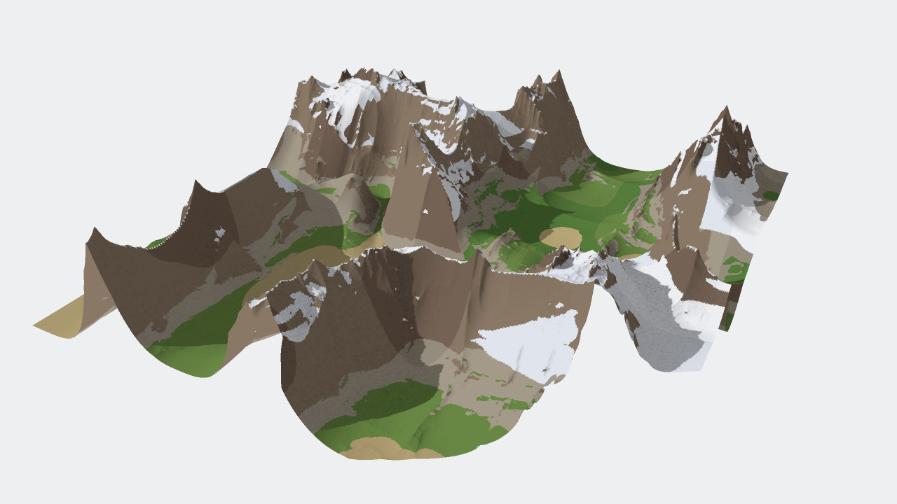
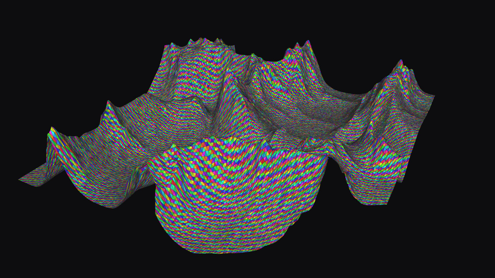
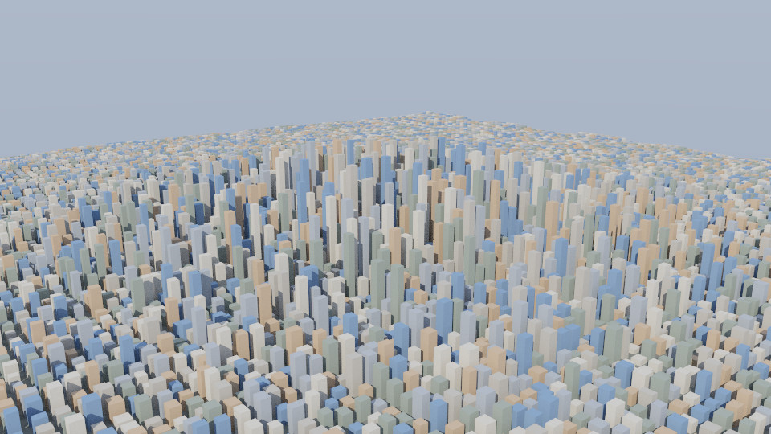
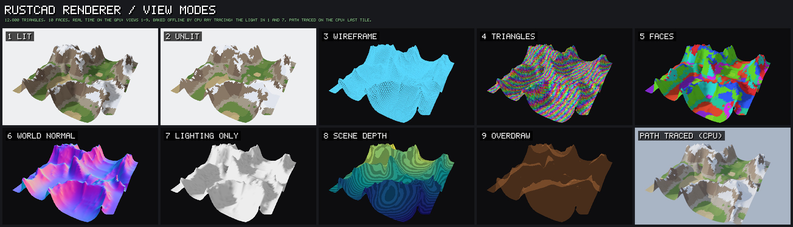
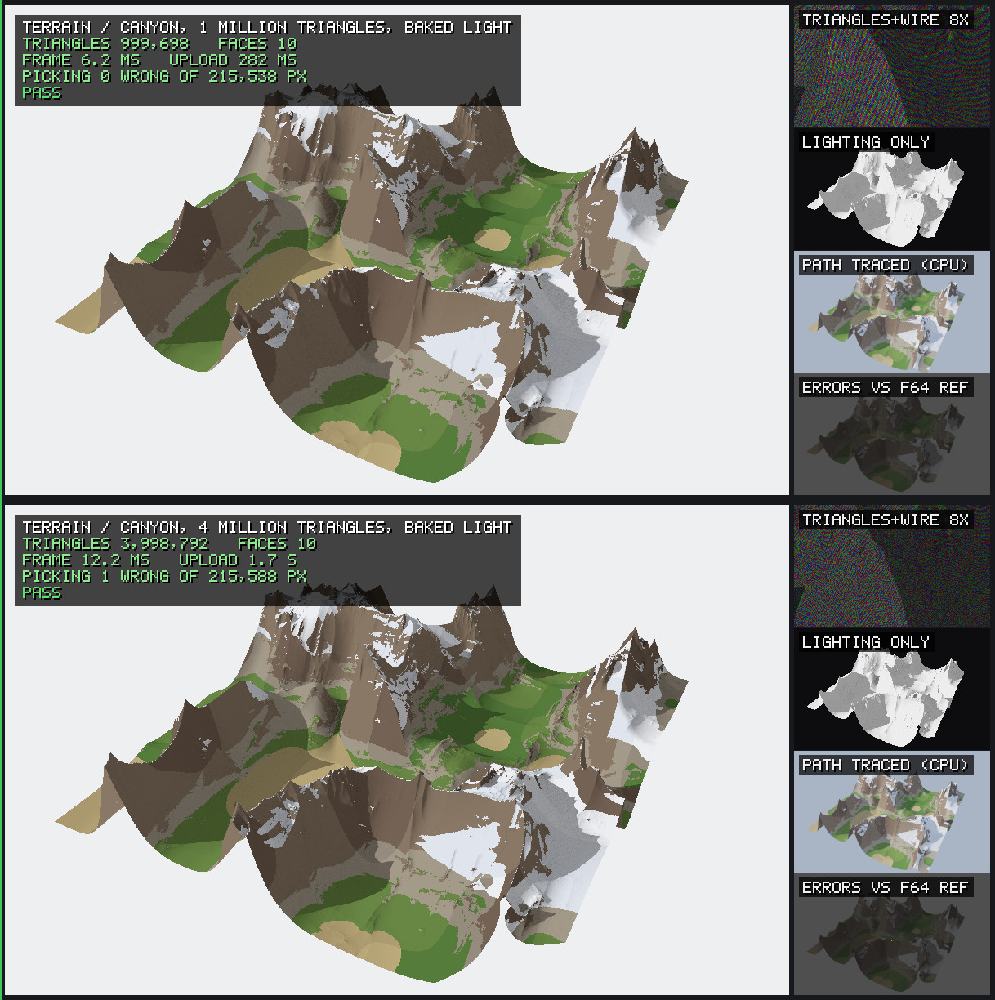
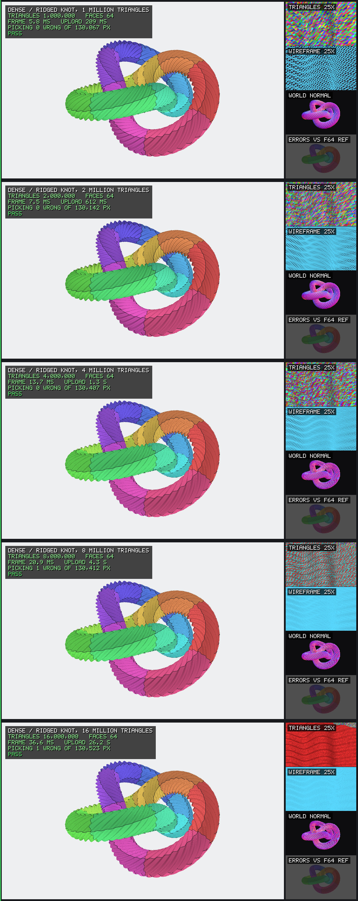
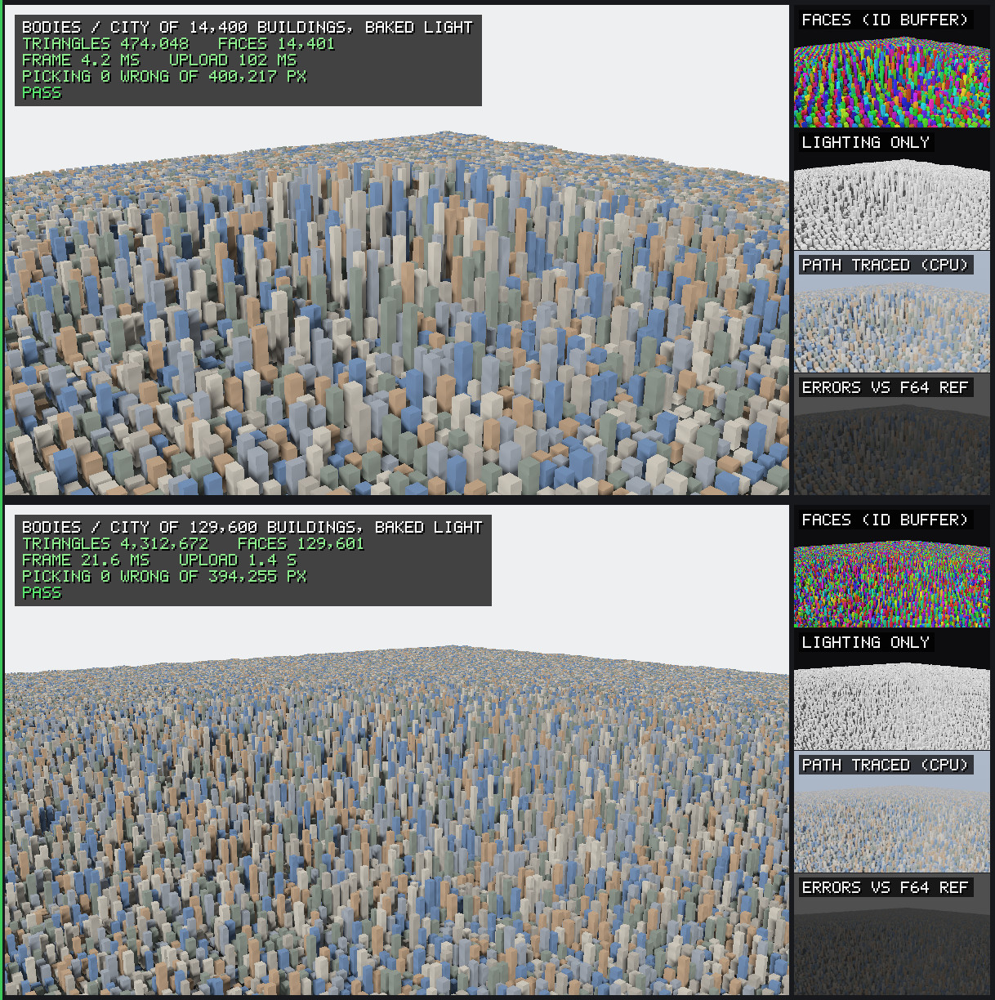
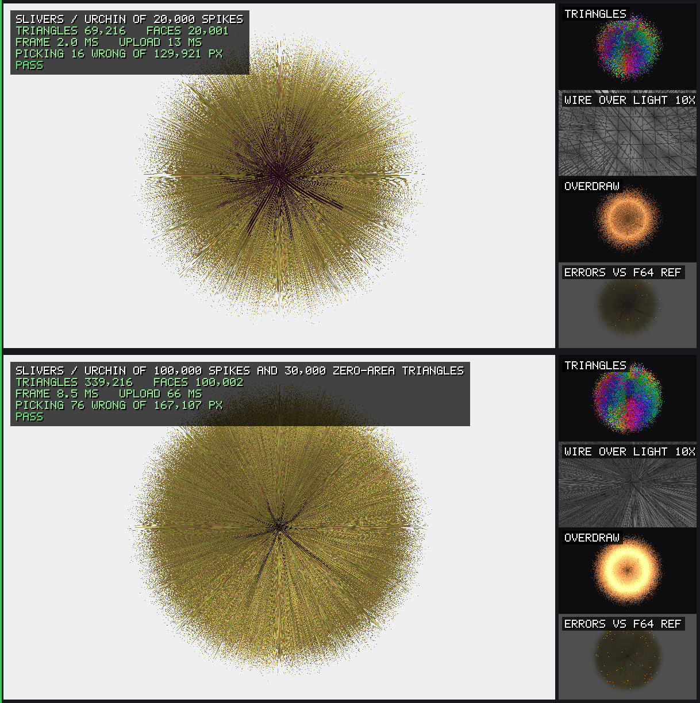
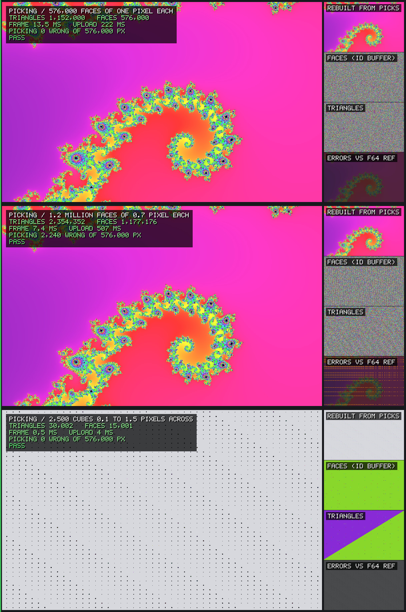

<h1 align="center">RustCAD</h1>

<p align="center">
  <strong>Shape parts by hand. Change your mind later.</strong><br>
  A parametric CAD application for mechanical design, built in Rust.
</p>

<p align="center">
  
</p>

RustCAD pairs direct modelling with a full feature history. Push and pull geometry the way
you would with clay, and every step stays recorded and editable, so a dimension chosen on
day one can still be changed on day one hundred. It is meant to be easy to learn, quick
under the hand, and deep enough for real engineering.

> **Status: early foundations.** The geometry kernel and the renderer work and are tested.
> There is no application to use yet.

## Where it stands

| | Today |
|---|---|
| **Geometry** | OpenCascade 7.9.3 behind a `Kernel` trait: boxes, union, subtract, intersect, tessellation, mass properties. Every boolean reports what became of each face. |
| **Rendering** | A wgpu renderer with shaded faces and edges, in a window or straight to PNG. About 2 ms per frame for a million triangles on an Apple M2, tested up to 16 million, with engine-style view modes, baked ray-traced lighting, and a path tracer ([rendering and torture tests](#rendering-and-torture-tests)). |
| **Picking** | Click a pixel, get the face beneath it. |
| **Naming** | Faces are named by the feature that made them, so references outlive edits to earlier steps. A spike, with one known flaw written up. |
| **Isolation** | The kernel can run in a separate worker process. If it crashes or hangs, the call fails cleanly and a fresh worker takes over. About 10 to 40 microseconds added per call. |
| **Testing** | Golden files check any kernel against expected volume, area, bounds, and face count. Snapshots check renders against reference images within a threshold. One script runs every merge gate. |

Verified on macOS with Apple Silicon. Linux and Windows are intended and not yet tested.

Still to come before it is an application: sketching, features beyond boxes and booleans,
the document model, undo, file formats, the interface, the command line tool, the agent
server, and plugins.

## Where it is going

**Modelling**
- Direct push and pull over a recorded, editable history
- A constraint-based 2D sketcher
- Extrude, revolve, sweep, loft, fillet, chamfer, shell, draft, rib, holes, and threads
- Linear, circular, and mirror patterns
- Named parameters and unit-checked expressions in every numeric field
- References that survive upstream edits, and never rebind silently

**Interface**
- A fast viewport with crisp edges, section views, and clear selection
- A toolbar that adapts to what is selected
- Command palette, inspector, history, and parameters panels

**Files**
- A native format with autosave and crash recovery
- STEP, STL, and 3MF in and out

**Automation**
- A built-in MCP server, so AI agents can drive every operation through typed, transactional tools
- Sandboxed WebAssembly plugins with declared capabilities
- A headless command line tool for batch work and export

**Further out**
- Assemblies, joints, and interference checks
- 2D drawings with PDF and DXF export
- Surfacing and sheet metal

Linux, macOS, and Windows. No account, no network connection.

The order of work is in [ROADMAP.md](ROADMAP.md), and the full design in
[docs/PLAN.md](docs/PLAN.md).

## Getting started

With a recent stable Rust toolchain:

```sh
cargo build --workspace
bash scripts/gates.sh        # everything that must pass before a merge
```

The OpenCascade backend is optional. Without it the workspace still builds and its tests are
skipped. To build it you need git, CMake, Ninja, and a C++17 compiler:

```sh
bash crates/cad-kernel-occt/native/build-occt.sh target/occt
```

This fetches and builds a pinned OpenCascade release, about five minutes on an Apple M2.
The next `cargo build` picks it up from `target/occt/install`; set `OCCT_ROOT` to point
elsewhere.

### See it run

```sh
# Model a part with OpenCascade and render it to a PNG (needs the backend)
cargo run -p cad-testkit --example demo -- part.png

# An orbiting box in a window; click a face to print its index
cargo run -p cad-render --example viewport

# A box rendered to a PNG, no window
cargo run -p cad-render --example snapshot -- box.png

# Frame time for a million triangles
cargo run --release -p cad-render --example bench
```

## Rendering and torture tests

> **⚠️ These demos are meant to be hard on your machine.** The largest cases build meshes of
> 16 million triangles, bake light into millions of vertices by ray tracing, and need several
> GB of memory. Your computer may slow down while they run. Close other heavy applications
> first. On a machine with less than 8 GB of memory, run one demo at a time. Ctrl+C stops them.

<p align="center">
  
  <br><em>A canyon of 1 million triangles. Drawn in real time by the GPU, in light baked offline by CPU ray tracing: sun shadows and ambient occlusion.</em>
</p>

<p align="center">
  
  
  <br><em>Left: the Triangles view with the wire overlay, every triangle in its own colour, in real time. Right: a city of 14,400 buildings, path traced on the CPU at 128 samples per pixel.</em>
</p>

The renderer is RustCAD's own, in [`crates/cad-render`](crates/cad-render), built on
[wgpu](https://wgpu.rs) (Metal, Vulkan, or DirectX) with shaders in WGSL; there is no game
engine underneath. The torture demos push it well past where a CAD viewport normally lives,
show how it works through engine-style view modes, and check what it draws instead of just
looking at it. Every case is rendered offscreen, then compared pixel by pixel with a slow CPU
rasterizer in double precision. If the GPU picks the wrong face for a pixel, the demo says
so, counts it, and exits with an error. It never quietly saves a wrong picture.

### What runs where

| | Where | What |
|---|---|---|
| **Real time** | GPU, every frame | Rasterizing every triangle, the face ID buffer used for picking, depth from each triangle's plane, edges, the wire overlay, and all nine view modes. |
| **Baked** | CPU, once per mesh | Light per vertex: sun shadows and sky ambient occlusion by ray tracing (`cad_render::trace::bake`). The GPU then draws in that light. Moving the sun in a demo window bakes again. |
| **Path traced** | CPU, offline | Reference images: sun with shadows, a sky, and two diffuse bounces (`cad_render::trace::path_trace`). Seconds to minutes per image, never interactive. |

There are no real-time shadow maps, real-time ambient occlusion, GPU ray tracing,
physically based materials, or anti-aliasing yet. They are next on the renderer track in
[ROADMAP.md](ROADMAP.md). The stills on this page are rendered at twice their size and
filtered down.

### How the renderer works



A mesh from the kernel is expanded to three vertices per triangle. Each vertex carries its
position (relative to the mesh's centre, so parts far from the origin keep full precision),
its normal, its face number, its face's colour, and its baked light. On upload, positions
that are not finite are refused, triangles with no area are left out, and zero-length
normals are replaced by the triangle's own. Each frame is one pass that writes the picture
and a face ID buffer holding the face number under every pixel; picking reads that buffer,
so clicking is exact to the pixel. Depth is stored reversed (1 at the near plane, 0 at the
far plane) and computed per pixel from the triangle's plane rather than interpolated, so
flush faces of different bodies tie exactly and the one drawn later wins. Face boundary
edges are drawn last, pulled 1.5 pixels' worth toward the eye so they stay in front of
their own faces.

| Key | View | What it shows |
|---|---|---|
| 1 | **Lit** | Face colours in baked light when the scene has it, otherwise lit from the eye, with edges. |
| 2 | **Unlit** | Base colour only. |
| 3 | **Wireframe** | Every triangle outlined. |
| 4 | **Triangles** | Every triangle in its own colour: how finely a surface is tessellated. |
| 5 | **Faces** | The face ID buffer made visible: what a click picks. |
| 6 | **World normal** | The surface normal as colour. |
| 7 | **Lighting only** | The light alone, on white: the bake, or the light from the eye. |
| 8 | **Scene depth** | Distance as a colour ramp, striped every 1/64 of the stored depth value. |
| 9 | **Overdraw** | Every triangle added up with no depth test: brightness counts the layers under each pixel. |

The wire overlay (W) outlines every triangle over any of these, as engines do over a shaded
view. In code: `Renderer::set_view_mode`, `set_wire_overlay`, `set_edges`, `upload_baked`,
the `trace` module, and `Navigation` for orbit, pan, and zoom to the cursor.

### Run them

Always build with `--release`; the debug build is too slow for these meshes.

```sh
# Every demo, headless; images go to target/torture/
cargo run --release -p cad-render --example torture
```

```sh
# One demo in a window
cargo run --release -p cad-render --example torture -- terrain --window
```

```sh
# Long boolean chains through OpenCascade (needs the backend)
cargo run --release -p cad-testkit --example occt_torture
```

In a window:

| Input | Does |
|---|---|
| Left drag | Orbit |
| Right drag, or Shift and left drag | Pan |
| Scroll, or pinch | Zoom toward the cursor |
| 1 to 9 | View mode |
| W / E | Wire overlay / face edges |
| `[` `]` / `-` `=` | Turn / raise the sun, and bake the light again |
| Space / R | Turntable / reset the view |
| Left and right arrows | Previous and next case |
| H / Esc | Hide the panel / quit |

A panel in the bottom left corner shows the case, the view mode, the toggles, the sun, the
triangle count, and the frame time. A click prints the face under the cursor.

The demos are `modes`, `terrain`, `dense`, `bodies`, `depth`, `zfight`, `slivers`, `thin`
and `picking`; add `--out DIR` to put the images elsewhere. The OpenCascade demo lives in
`cad-testkit`, because the renderer crate may not depend on the kernel backend.

### How to read the screenshots

Each row is one case. The large view is the main picture, with stats in the corner:
triangles, faces, frame time, upload time, and how many pixels picked the wrong face, then
**PASS** or **FAIL**. On the right are three technical views chosen for the case, and always
last, the error map against the double-precision reference: red marks a wrong face inside a
face, orange a wrong face at a boundary, magenta flush faces speckling. The stripe on the
left is green when every check in the case passed.

The demos write PNGs; the screenshots here are JPEG copies of the larger ones, to keep
the repository small. Numbers are from an Apple M2 with 8 GB of memory (Metal), main view 960 × 600. The final
run shared the machine with other applications, so frame times vary from run to run by
20% or more; the screenshots show the times measured in that run.

### Every view mode: `modes`

```sh
cargo run --release -p cad-render --example torture -- modes
```

The screenshot under [How the renderer works](#how-the-renderer-works): a canyon of 12,800
triangles, coarse enough that the Wireframe and Triangles views show single triangles, in
all nine views and path traced. This demo also writes the three stills at the top of this
section.

### Nanite-style terrain: `terrain`

```sh
cargo run --release -p cad-render --example torture -- terrain
```



A ridged fractal canyon of **1 and 4 million triangles**, faces following its terrain
classes (beach, grass, scree, rock, snow), lit by baked light: 13 ray-traced rays per vertex,
one toward the sun and twelve for ambient occlusion. The Triangles view with the wire
overlay, zoomed 8×, shows how dense the mesh is, as an engine shows a virtualized mesh.
Beside it, the light alone, then a path-traced reference. Both pass. The 4 million triangle
case draws in 12 ms; building its ray-tracing hierarchy takes 1.3 s and baking its 2 million
vertices 5.4 s.

### Triangle count: `dense`

```sh
cargo run --release -p cad-render --example torture -- dense
```



A knotted tube with spiral ridges and a ripple finer than the coarse meshes can follow,
refined from 1 million to **16 million triangles**. The ramp stops at the first size that
fails. Zoomed 25×, the Triangles and Wireframe views show what the full view cannot: at 1
million triangles each triangle is plain to see, at 16 million they are smaller than a pixel.

| Triangles | Upload | Frame | Wrong pixels |
|---:|---:|---:|---:|
| 1 M | 0.2 s | 5.8 ms | 0 |
| 2 M | 0.6 s | 7.5 ms | 0 |
| 4 M | 1.3 s | 13.7 ms | 0 |
| 8 M | 4.3 s | 20.9 ms | 0 |
| 16 M | 26 s | 36.6 ms | 0 |

All five pass. The 16 million triangle upload ran out of free memory on this 8 GB machine
and swapped; on a quiet machine it takes about 6 s, and the frame about 30 ms. Upload copies
every triangle's three vertices out separately and sorts every triangle side to find the
edges. The ceiling is the GPU's largest buffer: 4 GiB here, about 45 million triangles.

### Many bodies: `bodies`

```sh
cargo run --release -p cad-render --example torture -- bodies
```



A city of 14,400 and then **129,600 separate buildings**, each its own body and pick target,
in baked sun shadows and ambient occlusion. The large city is 4.3 million triangles drawn in
22 ms; baking its 5 million vertices takes 10 s. Both pass. The Faces view gives every
building its own colour. Face edges are off here: at this density, building outlines are
smaller than a pixel and drew the city black. Fading edges by their on-screen density is
part of the edges work on the renderer track.

### Depth range: `depth`

```sh
cargo run --release -p cad-render --example torture -- depth
```


An M3 bolt and a 1 mm cube on a workbench 60 mm from the eye, a road, a factory 300 m away
whose windows stand 20 mm proud of its wall, and a city 3 km away on the horizon, with the
near plane at 0.01 mm and then 20 mm. Then three 0.2 mm cubes 1 km from the origin. **All
three pass.** The windows come before the wall in the mesh, so draw order cannot paper over
a depth failure. Before reversed depth, depth from each triangle's plane, and positions
relative to the mesh's centre, all three failed: the far scene fought itself, the windows
vanished, and the far-off cubes deformed.

### Coincident faces: `zfight`

```sh
cargo run --release -p cad-render --example torture -- zfight
```


A blue block with a lid lying flush on top, an orange block overlapping it with tops and
fronts flush, and a white label 0.001 mm and 0.00001 mm above its top. **All four pass.**
Where two bodies share a face, the one drawn later wins every pixel; the 0.00001 mm label,
about one part in 19 million of the distance, is drawn whole. Before depth came from each
triangle's plane, the overlapping bodies speckled on 40% of the shared area.

### Slivers and bad input: `slivers`

```sh
cargo run --release -p cad-render --example torture -- slivers
```



Sea urchins of 20,000 and **100,000 hair-thin spikes**, each spike three slivers tens of
thousands of times longer than they are thick, in baked light. The larger hides 30,000
zero-area triangles among its spikes; upload leaves them out, and nothing picks them. Then a
set of meshes that must be refused. **Everything passes**: empty meshes, missing vertices,
and NaN or infinite positions are refused with an error, and zero-length normals are lit
from the triangle's own normal. Baking the large urchin's million vertices takes 16 s.

### Thin walls: `thin`

```sh
cargo run --release -p cad-render --example torture -- thin
```


A heat sink of 40 fins, from 1 mm down to **0.0001 mm thick**, in baked light. Each fin's two
sides are separate faces, so a back side showing through the front is a wrong pick. **All
four pass**, including 0.01 mm fins with the clip planes left loose at 0.1 mm to 100 m.

### Picking at the pixel limit: `picking`

```sh
cargo run --release -p cad-render --example torture -- picking
```



The Mandelbrot set built from **576,000 faces of one pixel each**, then 1.2 million faces of
0.7 pixel, then 2,500 cubes from 0.1 to 1.5 pixels across. "Rebuilt from picks" colours each
pixel by the face its click returns, and nothing else, so a perfect copy means picking is
exact. All three pass. With 0.7-pixel faces, about one pixel centre in seven lands exactly on
an edge, and the GPU's choice there counts as within precision.

### Boolean chains: `occt_torture`

```sh
cargo run --release -p cad-testkit --example occt_torture
```


A plate cut by **256 pockets** and a **union of 256 overlapping boxes**, one boolean at a
time in OpenCascade, through the `Kernel` trait, then tessellated and rendered. Both pass.
Volumes match the exact values within 2e-14 relative, every output face is accounted for in
the history maps, and no pixel picks the wrong face. Each boolean slows as the shape grows,
from tens of milliseconds to over a hundred; the Faces view shows that the union keeps every
split top face (1,946 faces), because the kernel does not yet merge coplanar faces.

## Inside the repository

| Path | |
|---|---|
| [`crates/`](crates) | The workspace. Each crate has one job and depends only on lower layers. |
| [`docs/PLAN.md`](docs/PLAN.md) | The full design: product, architecture, roadmap, testing. |
| [`docs/reports/`](docs/reports) | Findings from each foundation spike. |
| [`ARCHITECTURE.md`](ARCHITECTURE.md) | Short, binding rules for code. |
| [`DECISIONS.md`](DECISIONS.md) | Decisions later work must follow. |
| [`ROADMAP.md`](ROADMAP.md) | What is done and what is next. |
| [`NATIVE_DEPS.md`](NATIVE_DEPS.md) | Native libraries, versions, and licenses. |

## License

RustCAD is licensed under the GNU General Public License, version 3 or later
([LICENSE](LICENSE)). You may use, study, change, and share it. Anything you distribute that
is built on it must be offered under the same license, with its source.

OpenCascade is a separate library under LGPL-2.1 with the Open CASCADE exception. It is
fetched at build time and linked dynamically. This software uses facilities provided by the
Open CASCADE Technology software.
