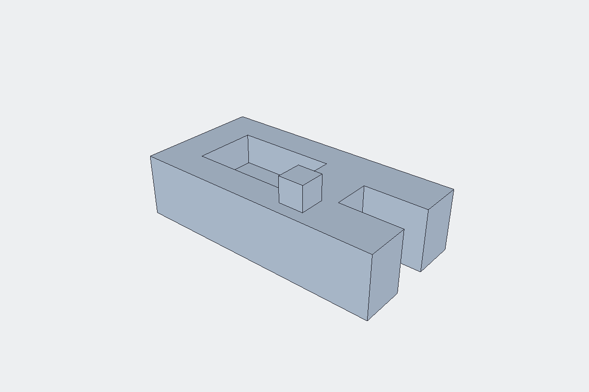
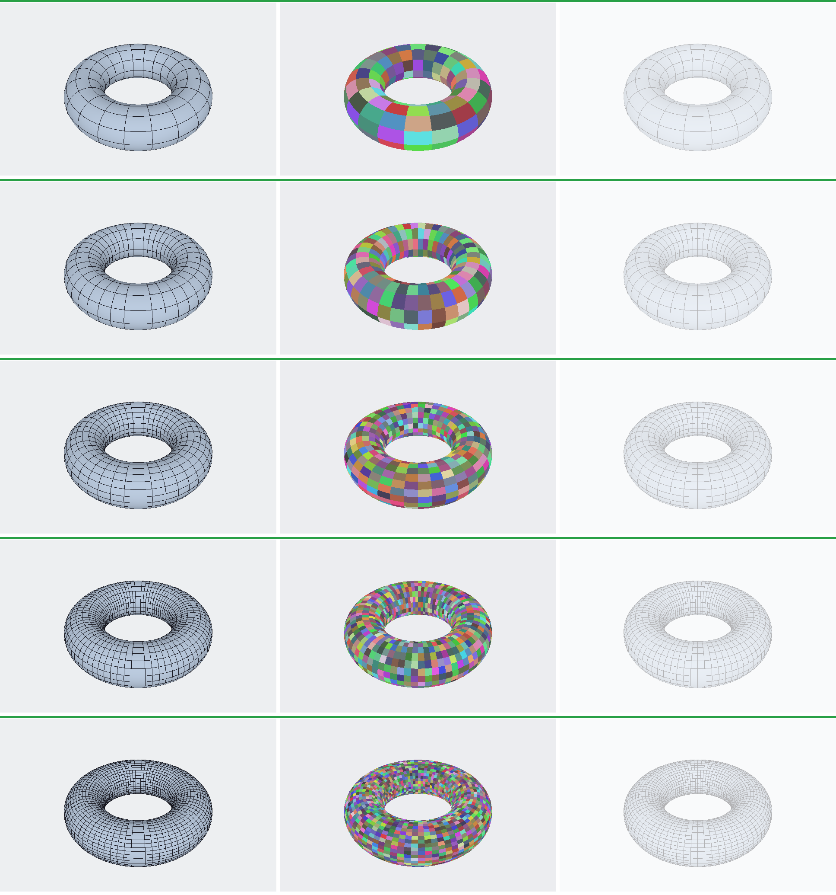
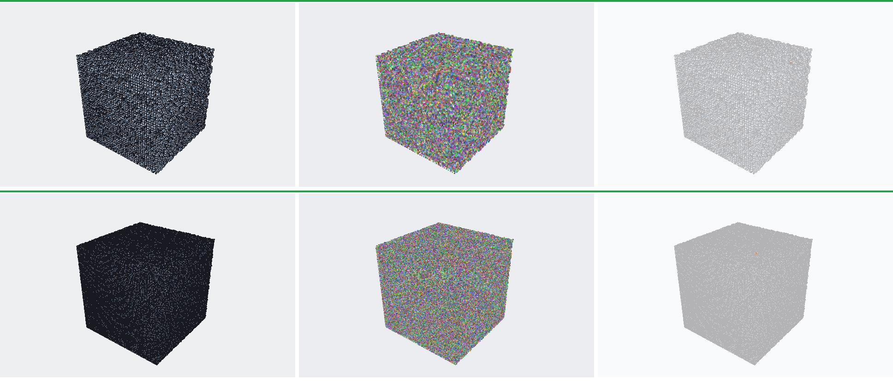
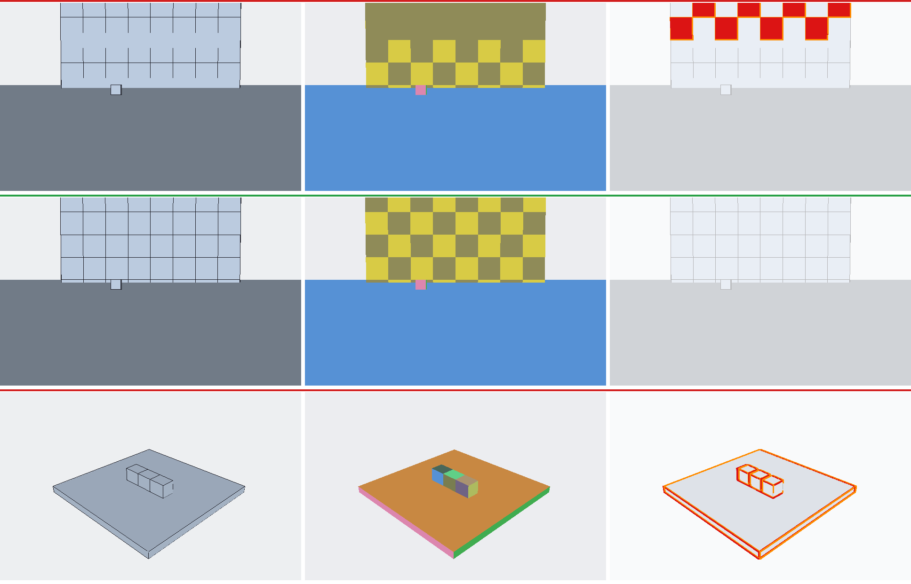
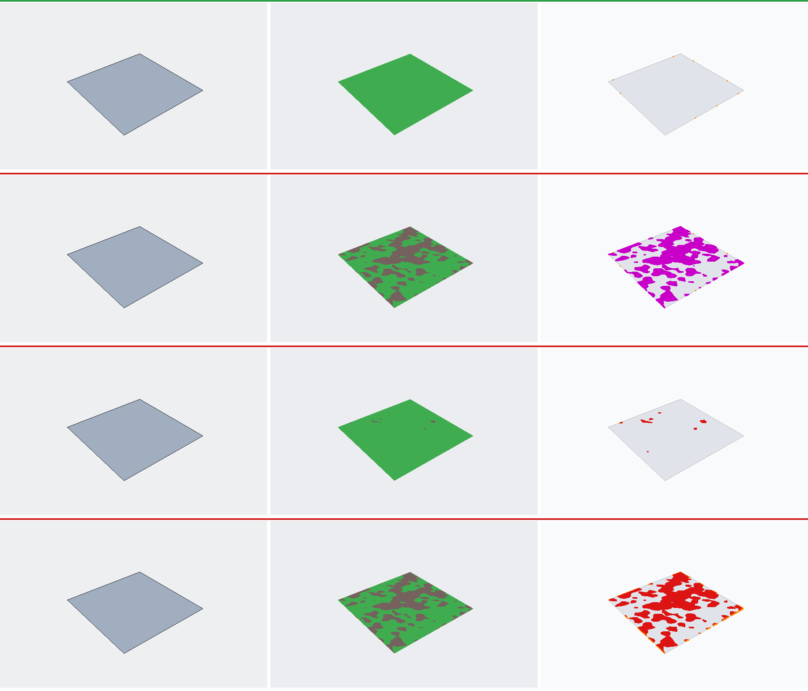
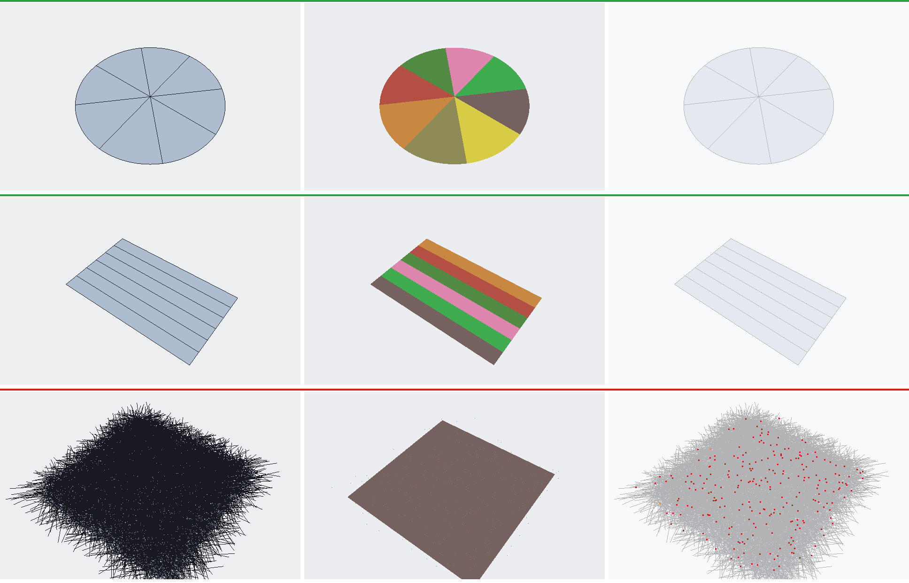
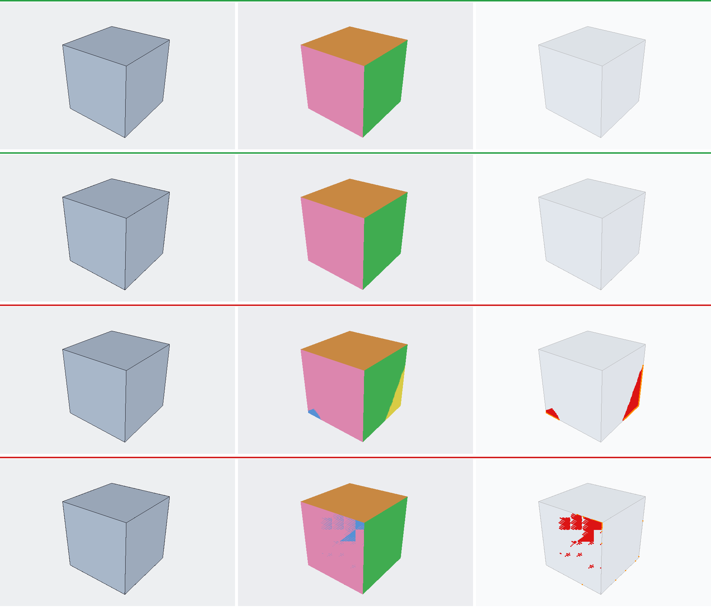
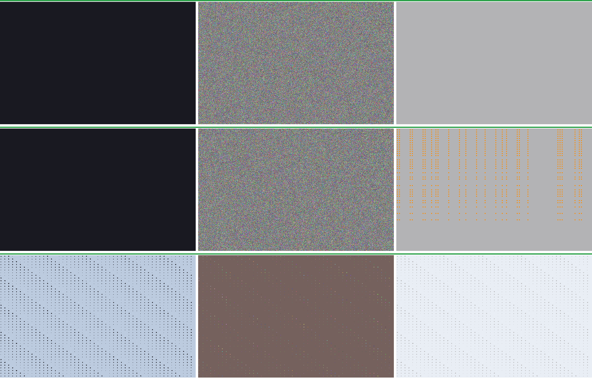
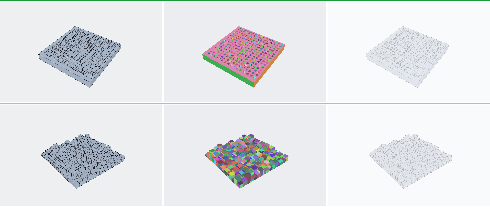

<h1 align="center">RustCAD</h1>

<p align="center">
  <strong>Shape parts by hand. Change your mind later.</strong><br>
  A parametric CAD application for mechanical design, built in Rust.
</p>

<p align="center">
  
</p>

RustCAD pairs direct modelling with a full feature history. Push and pull geometry the way
you would with clay, and every step stays recorded and editable, so a dimension chosen on
day one can still be changed on day one hundred. It is meant to be easy to learn, quick
under the hand, and deep enough for real engineering.

> **Status: early foundations.** The geometry kernel and the renderer work and are tested.
> There is no application to use yet.

## Where it stands

| | Today |
|---|---|
| **Geometry** | OpenCascade 7.9.3 behind a `Kernel` trait: boxes, union, subtract, intersect, tessellation, mass properties. Every boolean reports what became of each face. |
| **Rendering** | A wgpu renderer with shaded faces and edges, in a window or straight to PNG. About 2 ms per frame for a million triangles on an Apple M2, and tested up to 16 million ([torture tests](#torture-tests)). |
| **Picking** | Click a pixel, get the face beneath it. |
| **Naming** | Faces are named by the feature that made them, so references outlive edits to earlier steps. A spike, with one known flaw written up. |
| **Isolation** | The kernel can run in a separate worker process. If it crashes or hangs, the call fails cleanly and a fresh worker takes over. About 10 to 40 microseconds added per call. |
| **Testing** | Golden files check any kernel against expected volume, area, bounds, and face count. Snapshots check renders against reference images within a threshold. One script runs every merge gate. |

Verified on macOS with Apple Silicon. Linux and Windows are intended and not yet tested.

Still to come before it is an application: sketching, features beyond boxes and booleans,
the document model, undo, file formats, the interface, the command line tool, the agent
server, and plugins.

## Where it is going

**Modelling**
- Direct push and pull over a recorded, editable history
- A constraint-based 2D sketcher
- Extrude, revolve, sweep, loft, fillet, chamfer, shell, draft, rib, holes, and threads
- Linear, circular, and mirror patterns
- Named parameters and unit-checked expressions in every numeric field
- References that survive upstream edits, and never rebind silently

**Interface**
- A fast viewport with crisp edges, section views, and clear selection
- A toolbar that adapts to what is selected
- Command palette, inspector, history, and parameters panels

**Files**
- A native format with autosave and crash recovery
- STEP, STL, and 3MF in and out

**Automation**
- A built-in MCP server, so AI agents can drive every operation through typed, transactional tools
- Sandboxed WebAssembly plugins with declared capabilities
- A headless command line tool for batch work and export

**Further out**
- Assemblies, joints, and interference checks
- 2D drawings with PDF and DXF export
- Surfacing and sheet metal

Linux, macOS, and Windows. No account, no network connection.

The order of work is in [ROADMAP.md](ROADMAP.md), and the full design in
[docs/PLAN.md](docs/PLAN.md).

## Getting started

With a recent stable Rust toolchain:

```sh
cargo build --workspace
bash scripts/gates.sh        # everything that must pass before a merge
```

The OpenCascade backend is optional. Without it the workspace still builds and its tests are
skipped. To build it you need git, CMake, Ninja, and a C++17 compiler:

```sh
bash crates/cad-kernel-occt/native/build-occt.sh target/occt
```

This fetches and builds a pinned OpenCascade release, about five minutes on an Apple M2.
The next `cargo build` picks it up from `target/occt/install`; set `OCCT_ROOT` to point
elsewhere.

### See it run

```sh
# Model a part with OpenCascade and render it to a PNG (needs the backend)
cargo run -p cad-testkit --example demo -- part.png

# An orbiting box in a window; click a face to print its index
cargo run -p cad-render --example viewport

# A box rendered to a PNG, no window
cargo run -p cad-render --example snapshot -- box.png

# Frame time for a million triangles
cargo run --release -p cad-render --example bench
```

## Torture tests

> **⚠️ These demos are meant to be hard on your machine.** The largest cases build meshes of
> 16 million triangles, need several GB of memory, and keep the GPU busy for seconds at a
> time. Your computer may slow down while they run. Close other heavy applications first. On
> a machine with less than 8 GB of memory, run one demo at a time. Ctrl+C stops them.

The torture demos push the renderer past where a CAD viewport normally lives, and check what
it draws instead of just looking at it. Every case is rendered offscreen, then checked pixel
by pixel against a slow CPU rasterizer that works in double precision. If the GPU picks the
wrong face for a pixel, the demo says so, counts it, and exits with an error. It never quietly
saves a wrong picture.

### Run them

Always build with `--release`; the debug build is too slow for these meshes.

```sh
# Every demo, headless; images go to target/torture/
cargo run --release -p cad-render --example torture
```

```sh
# One or more demos by name
cargo run --release -p cad-render --example torture -- dense bodies
```

```sh
# Open a demo in a window: drag to orbit, scroll to zoom, click to print the face
# under the cursor, left and right arrows to switch case, Esc to quit
cargo run --release -p cad-render --example torture -- dense --window
```

```sh
# Long boolean chains through OpenCascade (needs the backend)
cargo run --release -p cad-testkit --example occt_torture
```

The demo names are `dense`, `bodies`, `depth`, `zfight`, `slivers`, `thin` and `picking`. Add
`--out DIR` to put the images somewhere else. The OpenCascade demo lives in `cad-testkit`,
because the renderer crate may not depend on the kernel backend. It draws through the same
`Kernel` trait as everything else.

### How to read the images

Each row is one case, in three panels. On the left is what the renderer drew. In the middle is
the face ID buffer, one colour per face. That is what a click picks, and it shows problems
the shaded picture hides: two faces in the same place look identical when shaded, but fight
visibly here. On the right is the error map, with the pixels where the GPU disagrees with the
reference painted in. Red means a wrong face in the middle of a face, orange means a wrong face
at a boundary, and magenta means two coincident faces speckling. The bar above a row is green
when every check in that case passed and red when one failed.

A pixel centre within a hundredth of a pixel of an edge can fall either way on a GPU, which
snaps vertices to a sub-pixel grid. Those pixels are counted and reported, but not treated as
errors.

Numbers below are from an Apple M2 with 8 GB of memory (Metal), 640 × 400 images.

### Triangle count: `dense`



A torus, refined from 1 million to **16 million triangles**. The ramp stops at the first size
the renderer fails.

| Triangles | Upload | Frame | Wrong pixels |
|---:|---:|---:|---:|
| 1 M | 0.8 s | 7.3 ms | 0 |
| 2 M | 1.2 s | 4.8 ms | 0 |
| 4 M | 2.6 s | 8.6 ms | 0 |
| 8 M | 6.5 s | 12.3 ms | 0 |
| 16 M | 10.6 s | 21.4 ms | 0 |

Frame times vary by a few milliseconds from run to run. All five pass. Drawing scales well, but upload does not. Upload copies each triangle's three
vertices out separately and sorts every triangle side to find the edges, which takes over ten
seconds at 16 million. The ceiling is the GPU's largest buffer: 4 GiB on this machine, or
about 51 million triangles. Before this work the renderer asked the GPU for default limits,
which cap a buffer at 256 MiB. Anything over about 3.2 million triangles hit a wgpu
validation error, and wgpu's default error handler panics.
It now asks for what the GPU supports, and refuses a mesh that is still too big with an error.

### Many bodies: `bodies`



64,000 and then **512,000 separate cubes** of random size: 6.1 million triangles and
3.1 million distinct face IDs, with 12 million edge segments. Both pass with no wrong
pixels. The large case draws in 30 ms.

### Depth range: `depth`



A 1 mm cube 30 mm from the eye, a wall 10 m away with panels standing 10 mm in front of it,
and a 200 m ground plane that runs behind the camera. The same scene is drawn twice, with the
near clip plane at 0.01 mm and then at 10 mm. A third case puts three 0.2 mm cubes 1 km from
the origin.

**Two of the three cases fail.**
- **Near plane at 0.01 mm:** the panels in front of the wall vanish, and 6.6% of the picture
  picks the wrong face. The depth buffer cannot separate 10 mm at 10 m when the near plane
  is that close. With the near plane at 10 mm, everything is correct.
- **1 km from the origin:** vertex positions go to the GPU in single precision, which only
  resolves about 0.06 mm at 1 km. The cubes deform, and 7% of the picture is wrong.
  Rendering relative to the camera would fix this.

### Coincident faces: `zfight`



Two plates belonging to different bodies, in the same plane or very close to it.

**Three of the four cases fail.**
- **Same plane, same triangulation:** passes. The plate drawn second always wins.
- **Same plane, different triangulation:** the two faces speckle. 37% of the plate picks the
  "losing" face. The shaded picture looks clean, because both faces have the same colour; only
  the ID buffer shows the problem. Faces of two touching bodies will do this.
- **0.001 mm apart:** wrong in a few patches, 0.4% of the plate.
- **0.00001 mm apart:** about the same as the same-plane case.

### Slivers and bad input: `slivers`



A disk made of 200,000 fan triangles, each 1.6 micrometres wide at the rim. A sheet of
600,000 needle triangles with an aspect ratio of 500,000 to 1. A plate behind 30,000
zero-area triangles. Then a set of meshes that should be refused.

The slivers and needles pass, with no cracks and no wrong pixels. **These fail:**
- **Zero-area triangles show up in picking:** 252 pixels pick a face that has no area,
  because the GPU's snapped vertices give those triangles a little coverage. The fix is to
  drop degenerate triangles when the mesh is uploaded.
- **NaN and infinite vertex positions** are accepted without an error.
- **Zero-length normals** are accepted and drawn almost black.

Empty meshes and missing vertices are refused correctly.

### Thin walls: `thin`



A hollow 40 mm box. The inner faces must never show through the outer ones.

**Two of the four cases fail.** Walls of 1 mm and 0.01 mm are correct when the clip planes
fit the part. A 0.0001 mm wall leaks 3.6% of inner-face pixels. A 0.01 mm wall leaks 2.8%
when the clip planes are left loose (0.1 mm to 100 m). Fitting the clip planes to the model
matters, and a reversed depth buffer would buy a lot of headroom.

### Picking at the pixel limit: `picking`



256,000 faces exactly one pixel each, 520,000 faces of 0.7 pixel, and 2,500 cubes from 0.1
to 1.5 pixels across. All pass. Every one-pixel face picks correctly. In the 0.7-pixel grid,
about one pixel centre in nine lands exactly on a face edge, and the GPU's choice there is
counted as within precision rather than as wrong.

### Boolean chains: `occt_torture`



A plate cut by **256 pockets**, one boolean at a time, and a **union of 256 overlapping
boxes**. Both are built in OpenCascade, tessellated, and rendered. Both pass. The volumes
match the exact values within 2e-14 relative, every output face is accounted for in the history maps, and
the pictures have no wrong pixels. Each boolean gets slower as the shape grows: 16 ms for the
first cut and 97 ms for the last, 12 s for the whole chain. The union keeps every split top
face (1,946 faces), because the kernel does not yet merge coplanar faces.

### What the demos changed

Edges in rendered images used to break into dashes on curved and steep faces. A line pixel's
centre can sit up to half a pixel off the true edge, and the old fixed depth offset was too
small to keep the line in front of its own face there. Edges now move toward the eye by
1.5 pixels' worth of depth at their distance, so they stay solid without shifting any face.

## Inside the repository

| Path | |
|---|---|
| [`crates/`](crates) | The workspace. Each crate has one job and depends only on lower layers. |
| [`docs/PLAN.md`](docs/PLAN.md) | The full design: product, architecture, roadmap, testing. |
| [`docs/reports/`](docs/reports) | Findings from each foundation spike. |
| [`ARCHITECTURE.md`](ARCHITECTURE.md) | Short, binding rules for code. |
| [`DECISIONS.md`](DECISIONS.md) | Decisions later work must follow. |
| [`ROADMAP.md`](ROADMAP.md) | What is done and what is next. |
| [`NATIVE_DEPS.md`](NATIVE_DEPS.md) | Native libraries, versions, and licenses. |

## License

RustCAD is licensed under the GNU General Public License, version 3 or later
([LICENSE](LICENSE)). You may use, study, change, and share it. Anything you distribute that
is built on it must be offered under the same license, with its source.

OpenCascade is a separate library under LGPL-2.1 with the Open CASCADE exception. It is
fetched at build time and linked dynamically. This software uses facilities provided by the
Open CASCADE Technology software.
