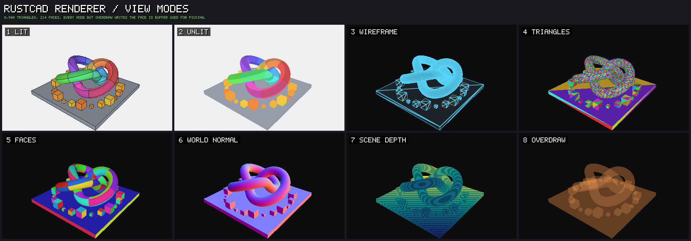

<h1 align="center">RustCAD</h1>

<p align="center">
  <strong>Shape parts by hand. Change your mind later.</strong><br>
  A parametric CAD application for mechanical design, built in Rust.
</p>

<p align="center">
  
</p>

RustCAD pairs direct modelling with a full feature history. Push and pull geometry the way
you would with clay, and every step stays recorded and editable, so a dimension chosen on
day one can still be changed on day one hundred. It is meant to be easy to learn, quick
under the hand, and deep enough for real engineering.

> **Status: early foundations.** The geometry kernel and the renderer work and are tested.
> There is no application to use yet.

## Where it stands

| | Today |
|---|---|
| **Geometry** | OpenCascade 7.9.3 behind a `Kernel` trait: boxes, union, subtract, intersect, tessellation, mass properties. Every boolean reports what became of each face. |
| **Rendering** | A wgpu renderer with shaded faces and edges, in a window or straight to PNG. About 2 ms per frame for a million triangles on an Apple M2, tested up to 16 million, with engine-style view modes ([torture tests](#torture-tests)). |
| **Picking** | Click a pixel, get the face beneath it. |
| **Naming** | Faces are named by the feature that made them, so references outlive edits to earlier steps. A spike, with one known flaw written up. |
| **Isolation** | The kernel can run in a separate worker process. If it crashes or hangs, the call fails cleanly and a fresh worker takes over. About 10 to 40 microseconds added per call. |
| **Testing** | Golden files check any kernel against expected volume, area, bounds, and face count. Snapshots check renders against reference images within a threshold. One script runs every merge gate. |

Verified on macOS with Apple Silicon. Linux and Windows are intended and not yet tested.

Still to come before it is an application: sketching, features beyond boxes and booleans,
the document model, undo, file formats, the interface, the command line tool, the agent
server, and plugins.

## Where it is going

**Modelling**
- Direct push and pull over a recorded, editable history
- A constraint-based 2D sketcher
- Extrude, revolve, sweep, loft, fillet, chamfer, shell, draft, rib, holes, and threads
- Linear, circular, and mirror patterns
- Named parameters and unit-checked expressions in every numeric field
- References that survive upstream edits, and never rebind silently

**Interface**
- A fast viewport with crisp edges, section views, and clear selection
- A toolbar that adapts to what is selected
- Command palette, inspector, history, and parameters panels

**Files**
- A native format with autosave and crash recovery
- STEP, STL, and 3MF in and out

**Automation**
- A built-in MCP server, so AI agents can drive every operation through typed, transactional tools
- Sandboxed WebAssembly plugins with declared capabilities
- A headless command line tool for batch work and export

**Further out**
- Assemblies, joints, and interference checks
- 2D drawings with PDF and DXF export
- Surfacing and sheet metal

Linux, macOS, and Windows. No account, no network connection.

The order of work is in [ROADMAP.md](ROADMAP.md), and the full design in
[docs/PLAN.md](docs/PLAN.md).

## Getting started

With a recent stable Rust toolchain:

```sh
cargo build --workspace
bash scripts/gates.sh        # everything that must pass before a merge
```

The OpenCascade backend is optional. Without it the workspace still builds and its tests are
skipped. To build it you need git, CMake, Ninja, and a C++17 compiler:

```sh
bash crates/cad-kernel-occt/native/build-occt.sh target/occt
```

This fetches and builds a pinned OpenCascade release, about five minutes on an Apple M2.
The next `cargo build` picks it up from `target/occt/install`; set `OCCT_ROOT` to point
elsewhere.

### See it run

```sh
# Model a part with OpenCascade and render it to a PNG (needs the backend)
cargo run -p cad-testkit --example demo -- part.png

# An orbiting box in a window; click a face to print its index
cargo run -p cad-render --example viewport

# A box rendered to a PNG, no window
cargo run -p cad-render --example snapshot -- box.png

# Frame time for a million triangles
cargo run --release -p cad-render --example bench
```

## Torture tests

> **⚠️ These demos are meant to be hard on your machine.** The largest cases build meshes of
> 16 million triangles, need several GB of memory, and keep the GPU busy for seconds at a
> time. Your computer may slow down while they run. Close other heavy applications first. On
> a machine with less than 8 GB of memory, run one demo at a time. Ctrl+C stops them.

The torture demos push the renderer well past where a CAD viewport normally lives, and they
show it working the way game engine editors do: a lit view with live stats, next to technical
views of what the renderer actually computed. They also check what it draws instead of just
looking at it. Every case is rendered offscreen, then compared pixel by pixel with a slow CPU
rasterizer that works in double precision. If the GPU picks the wrong face for a pixel, the
demo says so, counts it, and exits with an error. It never quietly saves a wrong picture.

### How the renderer works



The renderer is RustCAD's own, about 1,500 lines of Rust and WGSL in [`crates/cad-render`](crates/cad-render).
It is built on [wgpu](https://wgpu.rs), which runs on Metal, Vulkan, or DirectX, with shaders
in WGSL; there is no game engine underneath. A mesh from the kernel is expanded to three
vertices per triangle. Each vertex carries its position, normal, face number, and the face's
colour. Positions are stored relative to the centre of the mesh, and the camera is moved to
match in double precision, so a small part far from the world origin keeps full precision.
On upload, positions that are not finite are refused, triangles with no area are left out,
and a zero-length normal is replaced by its triangle's own. Each frame is one pass with a
32-bit depth buffer that writes two images at once: the picture, and a face ID buffer
holding the face number under every pixel. Depth is stored reversed, 1 at the near plane and
0 at the far plane. Floating point numbers are densest near zero, so that spends their
precision on distant surfaces, which the perspective divide leaves with the least of it. Picking reads
that second image, so clicking is exact to the pixel. Face boundaries, found on the CPU when
the mesh is uploaded, are drawn last as lines, pulled 1.5 pixels' worth of depth toward the
eye so they stay in front of their own faces.

Like an engine's view modes, the renderer can show any of eight views. Press 1 to 8 in a demo
window to switch, or call `Renderer::set_view_mode`.

| | View | What it shows |
|---|---|---|
| 1 | **Lit** | The model: face colours, lit from the eye, with edges. |
| 2 | **Unlit** | Base colour only: no lighting, no edges. |
| 3 | **Wireframe** | Every triangle's outline, from the corner each vertex carries. |
| 4 | **Triangles** | Every triangle in its own colour: how finely a surface is tessellated. |
| 5 | **Faces** | The face ID buffer made visible: what a click would pick. |
| 6 | **World normal** | The surface normal as colour. |
| 7 | **Scene depth** | Distance as a colour ramp, striped every 1/64 of the stored depth value. The stripes crowd toward the near plane, where the stored value changes fastest; because depth is reversed, a float still keeps fine steps beyond the last stripe. |
| 8 | **Overdraw** | Every triangle added up, with the depth test off: brightness counts the layers under each pixel. |

### Run them

Always build with `--release`; the debug build is too slow for these meshes.

```sh
# Every demo, headless; images go to target/torture/
cargo run --release -p cad-render --example torture
```

```sh
# One or more demos by name
cargo run --release -p cad-render --example torture -- dense bodies
```

```sh
# Open a demo in a window. The model turns slowly; space pauses it. Keys 1 to 8 switch
# view mode, drag orbits, scroll zooms, a click prints the face under the cursor, the
# left and right arrows switch case, Esc quits.
cargo run --release -p cad-render --example torture -- dense --window
```

```sh
# Long boolean chains through OpenCascade (needs the backend)
cargo run --release -p cad-testkit --example occt_torture
```

The demo names are `modes`, `dense`, `bodies`, `depth`, `zfight`, `slivers`, `thin` and
`picking`. Add `--out DIR` to put the images somewhere else. The OpenCascade demo lives in
`cad-testkit`, because the renderer crate may not depend on the kernel backend. It draws
through the same `Kernel` trait as everything else.

### How to read the images

Each row is one case. The large view is what the renderer drew, with stats in the corner:
triangles, faces, frame time, upload time, and how many pixels picked the wrong face, then
**PASS** or **FAIL**. The column on the right holds three technical views chosen for that
case, and the last is always the error map against the double-precision reference. In the
error map, red marks a wrong face in the middle of a face, orange a wrong face at a boundary,
and magenta two coincident faces speckling. The stripe down the left of a row is green when
every check in that case passed and red when one failed.

A pixel centre within a hundredth of a pixel of an edge can land on either side on a GPU,
which snaps vertices to a sub-pixel grid. Those pixels are counted but not treated as errors.

Numbers are from an Apple M2 with 8 GB of memory (Metal), at 960 × 600.

### Triangle count: `dense`


A knotted tube with spiral ridges and a ripple finer than the coarse meshes can follow,
refined from 1 million to **16 million triangles**. The ramp stops at the first size that
fails. The zoomed views on the right show the difference the full view cannot. At 1 million
triangles, each triangle is plain to see and the ripple is lost. At 16 million, the
triangles are smaller than a pixel even at 25× and the ripple is smooth.

| Triangles | Upload | Frame | Wrong pixels |
|---:|---:|---:|---:|
| 1 M | 0.2 s | 3.3 ms | 0 |
| 2 M | 0.3 s | 4.6 ms | 0 |
| 4 M | 0.8 s | 8.2 ms | 0 |
| 8 M | 1.9 s | 15.0 ms | 0 |
| 16 M | 5.6 s | 27.4 ms | 0 |

All five pass. Drawing scales close to linearly with the triangle count, but upload is slow.
It copies every triangle's three vertices out separately and sorts every triangle side to
find the edges. The ceiling is the GPU's largest buffer: 4 GiB on this machine, or about 45
million triangles at 32 bytes per vertex. A mesh too large for the GPU is refused with an
error.

### Many bodies: `bodies`


A spiral galaxy of 128,000 and then **512,000 separate bodies**, each its own pick target:
6.1 million triangles and half a million distinct face IDs. Both pass. The Faces view shows
every body in its own colour, and the large case draws in 32 ms.

### Depth range: `depth`


An M3 bolt and a 1 mm cube on a workbench 60 mm from the eye, a road, and a factory 300 m
away whose windows stand 20 mm proud of the wall. The windows come before the wall in the
mesh, so draw order cannot paper over a depth failure. Then three 0.2 mm cubes 1 km from the
origin.

**All three cases pass, with no wrong pixels.** With the near plane at 0.01 mm, every far
surface lands in the last stripe of the Scene depth view, yet the windows, the road, and
its lane marks are all correct: the reversed depth buffer still tells 20 mm apart at
300 m. The cubes 1 km out are drawn as precisely as at the origin, because their positions
are stored relative to the part itself.

Before these fixes, all three failed. The near plane at 0.01 mm left 1.6% of the picture
wrong and made the road fight the floor. At 20 mm the windows vanished into the wall.
1 km out, single-precision positions deformed the cubes and left 7% of the picture wrong.

### Coincident faces: `zfight`


A blue block, with a second body: a lid lying flush on its top with the same triangles, an
orange block overlapping it with tops and fronts flush, and a white label 0.001 mm or
0.00001 mm above its top.

**Two of the four cases fail.**
- **Flush lid, same triangles:** passes. The body drawn second wins everywhere.
- **Overlapping bodies, flush faces:** the two faces speckle. 40% of the shared area shows
  the "losing" body, in orange-and-blue blotches in the Lit view itself. Bodies that touch
  in an assembly will do this. More depth precision cannot help, because the two faces are
  exactly in the same place: the fix is a rule for which body wins a tie.
- **Label 0.001 mm up:** passes.
- **Label 0.00001 mm up:** 15% of the block's pixels pick the wrong face, and the label
  breaks into islands. Ten nanometres at 19 cm is about one part in 19 million of the
  distance, below what a 32-bit float can resolve.

### Slivers and bad input: `slivers`


A starburst of 200,000 fan triangles, each 1.6 micrometres wide at the rim. A sheet of
600,000 needles with an aspect ratio of 500,000 to 1. A plate under 30,000 zero-area
triangles. Then a set of meshes that should be refused.

**All of it passes.** The slivers and needles have no cracks and no wrong pixels; their
Triangles and Wireframe views turn to noise and solid colour, with thousands of triangles per
pixel. The 30,000 zero-area triangles are left out at upload: the plate draws clean, nothing
picks them, and they draw no edges. NaN and infinite positions are refused with an error
that names the vertex, and zero-length normals are replaced by the triangle's own, so those
faces are lit. Empty meshes and missing vertices are refused as before.

Before these fixes, the zero-area triangles drew stray edge lines over the whole plate and
364 pixels picked them, bad positions were accepted silently, and zero-length normals drew
faces black.

### Thin walls: `thin`


An open-topped 40 mm box, blue outside, red inside, with a yellow rim. Red must never show
through blue.

**One of the four cases fails.** Walls of 1 mm and 0.01 mm are correct, and so is the
0.01 mm wall with clip planes left loose at 0.1 mm to 100 m, which leaked red on 3.1% of the
box's pixels before depth was reversed. A 0.0001 mm wall still leaks, on 3.6%: a tenth of a
micrometre at 13 cm is about one part in a million of the distance, at the edge of what
32-bit depth can tell apart.

### Picking at the pixel limit: `picking`


The Mandelbrot set built from **576,000 faces of one pixel each**, then from 1.2 million faces
of 0.7 pixel. Then 2,500 cubes from 0.1 to 1.5 pixels across. The "Rebuilt from picks" view
colours each pixel by the face its click would return, and nothing else, so a perfect copy of
the picture means picking is exact. All three pass, with no wrong pixels at one pixel per
face. With 0.7-pixel faces, about one pixel centre in seven lands exactly on an edge, and the
GPU's choice there counts as within precision.

### Boolean chains: `occt_torture`


A plate cut by **256 pockets**, one boolean at a time, and a **union of 256 overlapping
boxes**. Both are built in OpenCascade, tessellated, and rendered. Both pass. Volumes match
the exact values within 2e-14 relative, every output face is accounted for in the history
maps, and no pixel picks the wrong face. Each boolean gets slower as the shape grows: 16 ms
for the first cut and 93 ms for the last, 11 s for the whole chain. The Faces view shows that
the union keeps every split top face (1,946 faces), because the kernel does not yet merge
coplanar faces.

## Inside the repository

| Path | |
|---|---|
| [`crates/`](crates) | The workspace. Each crate has one job and depends only on lower layers. |
| [`docs/PLAN.md`](docs/PLAN.md) | The full design: product, architecture, roadmap, testing. |
| [`docs/reports/`](docs/reports) | Findings from each foundation spike. |
| [`ARCHITECTURE.md`](ARCHITECTURE.md) | Short, binding rules for code. |
| [`DECISIONS.md`](DECISIONS.md) | Decisions later work must follow. |
| [`ROADMAP.md`](ROADMAP.md) | What is done and what is next. |
| [`NATIVE_DEPS.md`](NATIVE_DEPS.md) | Native libraries, versions, and licenses. |

## License

RustCAD is licensed under the GNU General Public License, version 3 or later
([LICENSE](LICENSE)). You may use, study, change, and share it. Anything you distribute that
is built on it must be offered under the same license, with its source.

OpenCascade is a separate library under LGPL-2.1 with the Open CASCADE exception. It is
fetched at build time and linked dynamically. This software uses facilities provided by the
Open CASCADE Technology software.
